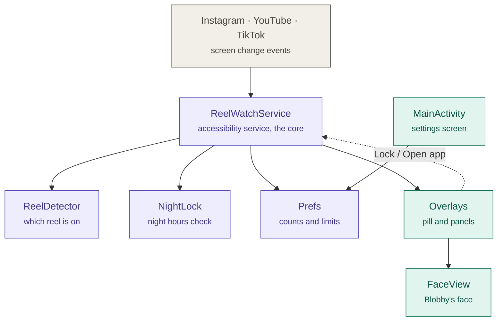

# ScrollGuard

An Android app that counts the reels you swipe through in Instagram Reels, YouTube Shorts
and TikTok. It shows the count on screen and helps you stop doomscrolling.

## Features

- **Blobby, your brain buddy.** A floating pill at the top of the screen shows Blobby and your
  reel count for today, and only appears while you're watching reels. Blobby starts bright,
  green and happy. As you get closer to your limit it turns yellow, then tan, then grey. Its
  eyelids droop, its eyes lose focus, it frowns, and finally it melts and drools.
- **Tap the pill** for a panel with today's count, progress toward your limits, and three
  buttons: **Keep going**, **Lock reels for 30 min**, or **Open ScrollGuard**.
- **Daily and hourly limits.** Defaults are 100 reels a day and 40 in any rolling hour. When you
  hit one, you get two choices: close the app, or keep going for 10 more reels.
- **Night lock** (default 11:00 PM–9:00 AM). Reels and Shorts send you back out, and TikTok goes
  to the home screen. DMs, the feed and normal YouTube videos keep working.
- **Friction to unlock.** Turning off a running lock takes a 60-second wait and typing
  "I choose to scroll". You can't change the lock hours while the lock is running.
- **Private.** Everything stays on the phone, and the app has no internet permission.

## How it works

ScrollGuard uses an Android **Accessibility Service** (`ReelWatchService`) to read the screen of
the supported apps:



Each time the screen changes in a supported app:

1. `ReelWatchService` gets the event. Other apps are ignored, and checks are spaced at least
   250 ms apart.
2. If `NightLock` says it's night, or a 30-minute quick lock is running, the service presses Back
   or Home.
3. Otherwise, if a reel player is showing and the reel is new, `Prefs` adds one to the count.
4. `Overlays` updates the pill, and shows the limit panel when a limit is reached.

`MainActivity` (the app screen) never talks to the service directly. Both read and write the same
`Prefs`.

Each part in more detail:

- `ReelDetector` checks whether the reel player is on screen and works out which reel is
  showing, from its position in the feed and its author. Each new reel counts once.
- `Overlays` draws the pill, the panels and messages as accessibility overlays. They don't need
  the "Display over other apps" permission.
- `FaceView` draws Blobby on a canvas. Its look is driven by a single `dullness` value between
  0 and 1.

| App | How the reel player is detected |
|---|---|
| Instagram | view IDs `clips_viewer_view_pager`, `clips_viewer_root`, `clips_video_container` |
| YouTube | view IDs `reel_recycler`, `reel_player_page_container`, `reel_watch_player` |
| TikTok | shape: a full-screen vertical pager |

These view IDs can change when Instagram or YouTube update. If counting stops for one app, update
the lists in `ReelDetector.kt`.

## Build

You need JDK 17–21 and the Android SDK (platform 35). Open the project in Android Studio, or build
from the terminal:

```
./gradlew assembleDebug
# -> app/build/outputs/apk/debug/app-debug.apk
```

## Install

1. Install the APK with `adb install -r app/build/outputs/apk/debug/app-debug.apk`, or copy it to
   the phone and open it.
2. Open ScrollGuard → **Turn it on** → enable **ScrollGuard reel counter**.
3. On Android 13 and later, the switch may be greyed out for apps installed from a file. Go to
   Settings → Apps → ScrollGuard → ⋮ → **Allow restricted settings**, then try again.
4. Set ScrollGuard's battery usage to **Unrestricted** so Android doesn't stop it in the background.

## Known limits

- Android doesn't let one app close another, so "Close" sends you to the home screen.
- Reels that play inside the Instagram home feed or Explore grid aren't counted yet.
- Turning off the accessibility service in Settings disables ScrollGuard. Android doesn't let an
  app prevent that.
